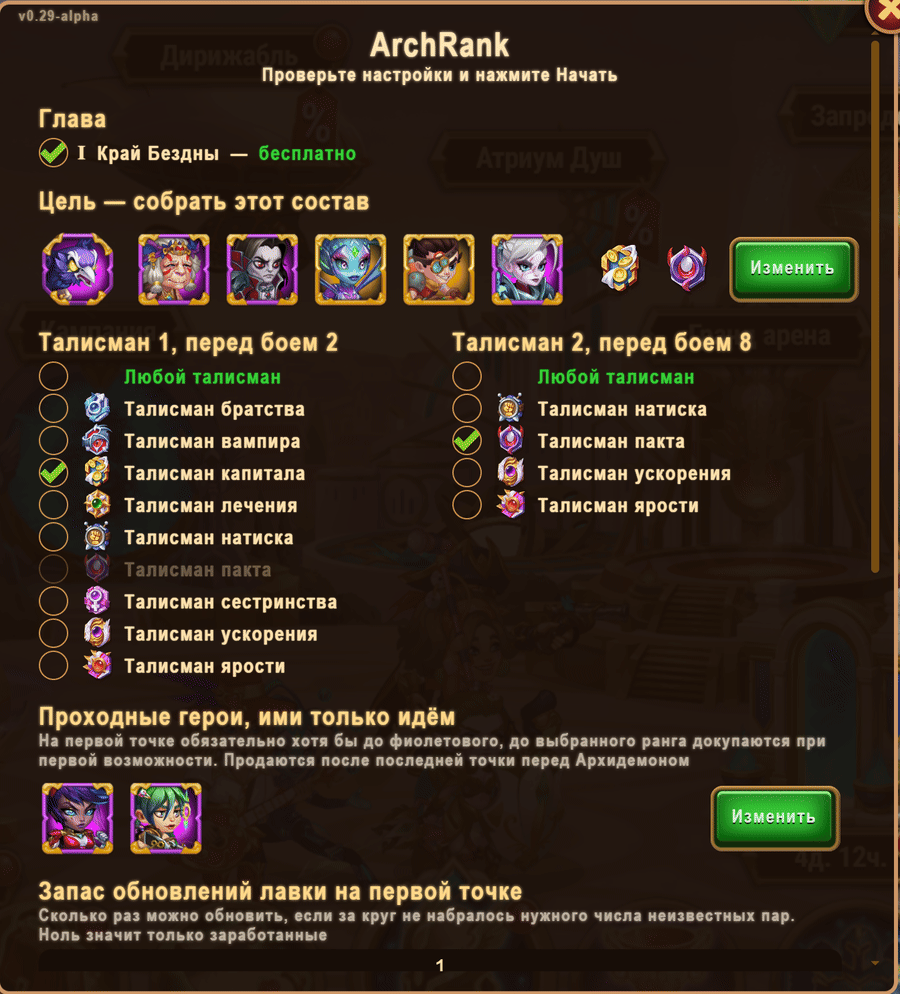
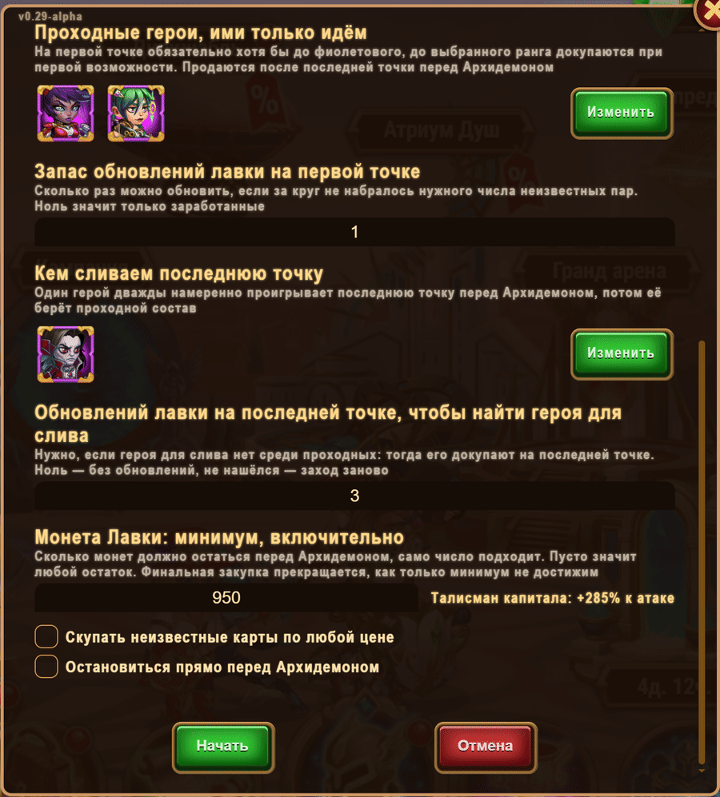

# HWHArchdemonExt

An add-on for HeroWarsHelper for the Archdemon event. It runs a free chapter that ends with the Archdemon — the Abyss
chapter or, as from 16.11.2026, any chapter of the event — collects the team you set and stops right before the
Archdemon — you attack yourself.
If a run does not work out, it resets the chapter and tries again.

## Features

- **The goal is picked like in the game** — with a “Gather the team” window: up to five heroes
  with ranks 80/100/130, patrons, the main pet and two emblems.
- **Regular run** — without the Emblem of Capital. It holds off buying until the stall has more slots:
  - on each point it buys the needed heroes; if there are none, one refresh, then the battle;
  - on point 1 it buys every unknown card;
  - a lost point is remembered and the chapter restarts; next time the team is changed;
  - the final shopping completes the team, selling extra pets when coins run short;
  - optionally stops before the Archdemon even if the team is not complete.
- **Run with the Emblem of Capital** — goes with cheap carry heroes, saves coins and buys
  the main team at the very end:
  - needed heroes are pinned in the shop along the way and bought in the final shopping,
    so coins are not spent early and go into the emblem bonus;
  - carry heroes with ranks, topped up along the chapter;
  - two deliberate losses for coins on a chosen point — any regular one, never the main boss;
  - resale of profitable lots;
  - discounted pets are bought out and sold later, so the shop offers more heroes;
  - minimum Shop Coins with the emblem bonus shown: the shopping stops once it is out of reach.
- **Ready-made builds** — teams of other players from open videos, collected on [HWDaily](https://hwdaily.win/) (by Fragator)
  and [HWMAP](https://hwmap.online/) (by Kircheis). One button runs the chapter with the chosen build. The builds are
  loaded from our server on Netlify or its mirrors on jsDelivr and GitHub, no player data is sent. Thanks to the video authors and to both sites.
- **Settings of their own for each chapter**, within the event only: what you fill in is kept, a new event starts empty.
- **Run log** on the right, a Stop button, an optional report before the final shopping.
- The chapter's main boss cannot be skipped: its result goes after the battle length, as the helper does.
- Paid chapters are never touched.
- Does not start a run when less than 10 minutes are left until the event ends.

## Install

HeroWarsHelper 2.459 or newer is required: with an older helper the run fails. Import `HWHArchdemonExt.user.js` into Tampermonkey. The script order does not matter: the add-on waits for the helper.
The item appears in the helper menu: **Others → Adventure (Arch)**.

While a run is going, turn off other scripts that improve Invasion battles: they intercept the add-on's
requests too and can turn an intentional loss into a win. And do not play manually in the same tab during a run.

## Screenshots

Show

